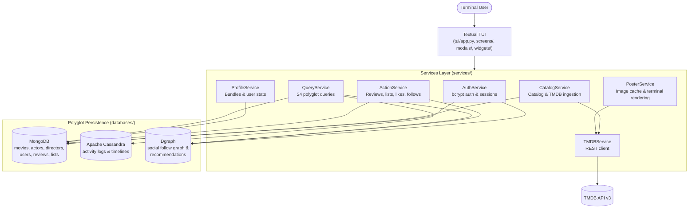
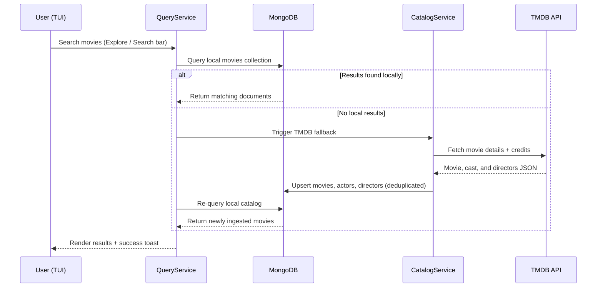

# MovieVault

MovieVault is a Letterboxd-inspired terminal application (TUI) built with **Textual** and a **polyglot persistence architecture** (**MongoDB**, **Apache Cassandra**, and **Dgraph**), integrated with the **TMDB API** to explore movies, cast/crew, reviews, custom lists, social graphs, and personalized statistics.

**Team members:**
- Brandon Michelle Pérez Saldaña
- Sofía Alejandra Cortez Jiménez
- Jorge Alberto Orozco Yañez

---

## Features & Scope

- **Movie Logging & Reviews**: Mark movies as watched, rate from `0.5` to `5.0` stars (in `0.5` increments), toggle movie likes, and publish or edit written reviews with viewing medium metadata (`Streaming`, `Theater`, `IMAX`, `Blu-ray`, etc.).
- **Custom Lists**: Create personal lists with descriptions, add/remove movies, and browse lists in a dedicated split workspace.
- **Recursive TMDB Ingestion**: Search local MongoDB catalogs by title, genre, country, rating, director, actor, decade, or synopsis keywords—automatically fetching and storing missing movies, actors, and directors from TMDB.
- **Social Graph & Interactions**: Follow/unfollow users, visit external profiles, view followers/following, like community reviews, and explore friend-based recommendations powered by Dgraph.
- **Activity Logs & Telemetry**: Query user activity histories and temporal interaction logs in Apache Cassandra.
- **User Profile & Wrapped**: Profile cards with custom avatar upload, paginated reviews (2 rows per page), watched movies grid, lists carousel, and a full-screen **Wrapped** summary with a PyFiglet header, horizontal genre bar chart, and interactive favorite actor/director cards.
- **Out of Scope**: Streaming/playing video inside the app, private direct messaging/chat, collaborative lists, and reviewing actors/directors directly.

---

## Architecture

MovieVault separates presentation (**Textual TUI**), business logic (**Services**), and polyglot data access (**Databases**):



### Search & Recursive Ingestion Flow



---

## Project Structure

```text
MovieVault/
├── config.py                     # Loads .env and database / TMDB settings
├── main.py                       # CLI & TUI entrypoint (--no-posters, --seed, --status)
├── pyproject.toml                # Project metadata & package configuration
├── requirements.txt              # Python dependencies
├── .env.example                  # Sample environment variables
├── data/
│   ├── populate.py               # Populates 50 TMDB movies + 30 interactive demo users
│   └── cache/posters/            # Cached TMDB poster images
├── databases/
│   ├── __init__.py               # Connection status & cleanup helpers
│   ├── connection.py             # Thread-safe Singleton BaseConnection ABC
│   ├── cassandra/                # Cassandra connection & activity queries
│   ├── dgraph/                   # Dgraph connection & social/recommendation queries
│   └── mongodb/                  # MongoDB connection, schema, validators & queries
├── public/
│   ├── avatars/                  # Uploaded user profile avatars
│   ├── default_movie.png         # Fallback movie poster
│   └── default_person.png        # Fallback person photo
├── services/
│   ├── ActionService.py          # Watched, movie/review likes, reviews, lists, follows
│   ├── AuthService.py            # Registration, bcrypt login, session switching
│   ├── CatalogService.py         # Local catalog queries & recursive TMDB ingestion
│   ├── PosterService.py          # Poster downloading, disk/memory caching
│   ├── ProfileService.py         # User profile bundles, reviews, watched & lists
│   ├── QueryService.py           # Unified executor for all 24 database requirements
│   └── TMDBService.py            # TMDB v3 HTTP client with throttling
└── tui/
    ├── app.py                    # MovieVaultApp root Textual application
    ├── styles.tcss               # Global Textual CSS styling
    ├── toast.py                  # Toast helpers (success, info, error)
    ├── modals/                   # Modular ModalScreen dialogs (BaseModal backdrop dismiss)
    │   ├── __init__.py
    │   ├── base.py               # BaseModal (closes on outside backdrop click)
    │   ├── auth.py               # UserSwitchModal, UserMenuModal
    │   ├── common.py             # ConfirmModal
    │   ├── lists.py              # ManageListModal, CreateListModal, AddMovieToListModal
    │   ├── profile.py            # EditProfileModal, UploadAvatarModal, FollowListModal, etc.
    │   └── review.py             # ReviewMovieModal, SearchReviewsModal
    ├── screens/
    │   ├── admin.py              # AdminScreen (24-query runner & DB diagnostics)
    │   ├── auth.py               # AuthScreen (Login / Register)
    │   ├── help.py               # HelpScreen (Keyboard shortcuts & guide)
    │   ├── settings.py           # SettingsScreen
    │   └── user/
    │       ├── home.py           # HomeScreen (Home, Lists, Explore, Profile tabs)
    │       ├── movie_detail.py   # MovieDetailScreen (Metadata, cast/crew, featured reviews)
    │       ├── person.py         # PersonScreen (Actor/director bio & filmography)
    │       ├── profile.py        # ProfileScreen (External user profile view)
    │       ├── query_results.py  # QueryResultsScreen (Tabular/card query output)
    │       ├── reviews.py        # ReviewsScreen (Keyword-filtered movie reviews)
    │       ├── search_results.py # SearchResultsScreen (Paginated movie search grid)
    │       └── wrapped.py        # WrappedScreen (PyFiglet header, genre chart & top people)
    └── widgets/                  # Reusable UI components
        ├── figlet_header.py      # PyFiglet ASCII header with plain-text fallback
        ├── loading_spinner.py    # Centered animated loading spinner
        ├── movie_card.py         # Interactive movie poster card
        ├── movie_grid.py         # Responsive grid with < > pagination
        ├── person_card.py        # Interactive actor/director card
        ├── poster.py             # Terminal pixel poster renderer
        ├── profile_view.py       # Shared profile widget (own & external profiles)
        └── state_message.py      # Loading / Empty (planet ASCII) / Error / Success states
```

---

## Prerequisites

- **Python** `3.11+`
- **MongoDB** (default `localhost:27017`)
- **Apache Cassandra** (default `localhost:9042`, keyspace `movievault`)
- **Dgraph** (default `localhost:9080`)
- **TMDB API** Read Access Token (`TMDB_READ_ACCESS_TOKEN`) for fetching movie/person metadata and posters

---

## Installation & Setup

1. **Clone the repository and enter the project folder:**
   ```bash
   git clone <your-repo-url>
   cd MovieVault
   ```

2. **Create a virtual environment and install dependencies:**
   Using `uv` (recommended):
   ```bash
   uv venv .venv
   source .venv/bin/activate
   uv pip install -r requirements.txt
   ```
   Or using standard `venv` + `pip`:
   ```bash
   python3 -m venv .venv
   source .venv/bin/activate
   pip install -r requirements.txt
   ```

3. **Configure environment variables:**
   Copy `.env.example` to `.env` and fill in your database and TMDB settings:
   ```bash
   cp .env.example .env
   ```
   Variables read by `config.py`:
   ```env
   # MongoDB
   MONGO_HOST=localhost
   MONGO_PORT=27017
   MONGO_DB_NAME=movievault

   # Apache Cassandra
   CASSANDRA_HOST=localhost
   CASSANDRA_PORT=9042
   CASSANDRA_KEYSPACE=movievault

   # Dgraph
   DGRAPH_HOST=localhost
   DGRAPH_PORT=9080

   # TMDB API
   TMDB_READ_ACCESS_TOKEN=your_tmdb_bearer_token_here
   BASE_TMDB_API_URL=https://api.themoviedb.org/3
   BASE_TMDB_IMAGE_URL=https://image.tmdb.org/t/p/w500
   ```

4. **Verify database connectivity:**
   ```bash
   ./.venv/bin/python main.py --status
   ```

---

## Populating Demo Data

To populate MongoDB with **50 TMDB movies** (recursively with their actors and directors), **30 test users**, custom lists, reviews, watched movies, follows, and cross-user review likes—and export all generated credentials to `users.txt`:

```bash
./.venv/bin/python data/populate.py
```

If you only want to seed `N` popular movies from TMDB without generating demo users:

```bash
./.venv/bin/python main.py --seed 50
```

---

## Running the Application

```bash
# Launch the interactive TUI (with terminal poster rendering)
./.venv/bin/python main.py

# Launch TUI in text-only mode (accessibility / low bandwidth)
./.venv/bin/python main.py --no-posters

# Run multi-database connection & 24-query diagnostic
./.venv/bin/python main.py --status
```

### TUI Navigation & Shortcuts

| Shortcut | Action |
| :--- | :--- |
| `Esc` | Go back / Close active modal (clicking outside a modal also closes it) |
| `Ctrl+N` | Open Review Movie modal (from Movie Details / Home) |
| `Enter` | Submit search/query forms or open selected movie/person card |
